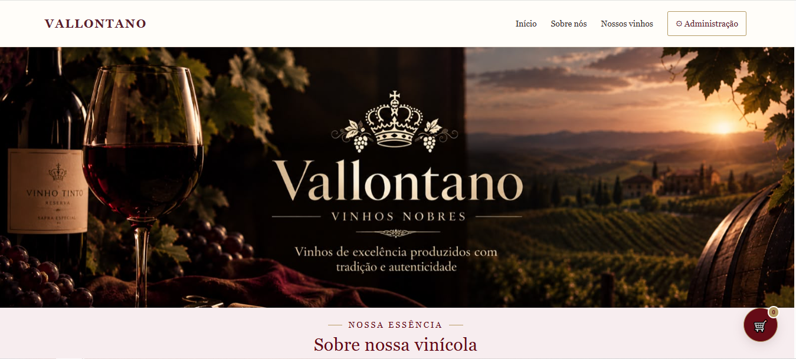

# Vallontano Vinhos Nobres 🍷

Projeto de um site de catálogo de vinhos desenvolvido para apresentar produtos de forma organizada e oferecer uma experiência de navegação simples e agradável.

## Sobre o projeto

O Vallontano Vinhos Nobres é um projeto web que permite visualizar um catálogo de vinhos e conta com uma área administrativa para gerenciar produtos e consultar pedidos.

## Prévia do projeto

## Funcionalidades

- Catálogo de vinhos.
- Exibição de informações e preços dos produtos.
- Área administrativa com acesso por login.
- Cadastro e gerenciamento de produtos.
- Visualização dos pedidos recebidos e dos respectivos itens.

## Tecnologias utilizadas

- PHP
- MySQL
- HTML
- CSS
- XAMPP
- GitHub

## Como executar o projeto localmente

1. Instale o XAMPP.
2. Inicie os serviços Apache e MySQL.
3. Coloque a pasta do projeto dentro de `C:\xampp\htdocs\`.
4. Acesse o phpMyAdmin pelo navegador.
5. Crie um banco de dados chamado `meu_catalogo`.
6. Importe um arquivo SQL de estrutura e dados de exemplo, caso esteja disponível.
7. Configure a conexão com o banco de dados no arquivo `config.php`.
8. Acesse `http://localhost/Vallontano/` no navegador.

## Observações

Este projeto utiliza PHP e MySQL e precisa de um ambiente compatível para funcionar. O GitHub é utilizado para armazenar e compartilhar o código-fonte.

## Autor

Projeto desenvolvido para fins de estudo e apresentação.
